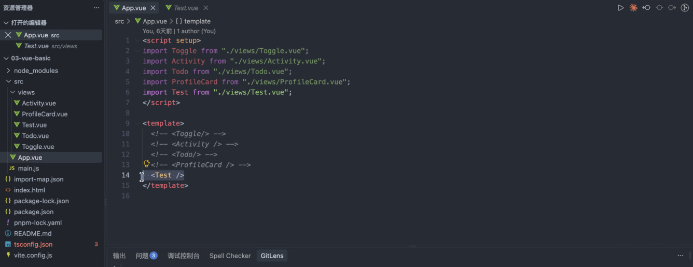

# 2026-09-21 课堂笔记 · Vue 模板语法进阶与 Element Plus 入门

> 讲师：许莫淇 ｜ 本节课项目：`03-vue-basic`（Vite + Vue3 + TypeScript + pnpm + Element Plus）
> 主题：端口排查 → 模板指令巩固 → 条件渲染 → Element Plus 组件库



---

## 一、课前热身：端口占用排查（必备技能）

- Mac/Linux 用 `lsof` 演示了「查找 → 终止」占用端口进程的标准流程，这是给后续排障打样。
- **Windows 下的对应命令被布置为强制课后作业**：必须用命令解决，不许走设置界面；后续开发必会遇到。
- 端口冲突是开发高频痛点（数据库、各类服务器启动失败多半是它），命令要熟记。

```bash
# Mac/Linux 参考（课上演示）
lsof -i :5173     # 查看占用 5173 端口的进程，拿到 PID
kill -9 <PID>     # 终止该进程
```

```bash
# Windows 作业（自查完成，关键词：netstat / taskkill）
netstat -ano | findstr :5173
taskkill /PID <PID> /F
```

---

## 二、Vue 模板语法巩固

本节暂缓计算属性，先结合实用库夯实基础，避免后续知识断层。**课上建议把官方「指令总览」表截图保存**。

### 2.1 核心指令：v-bind 与 v-on（都有语法糖）

特意强调语法糖的存在——写顺手了也不能忘了底层指令长什么样：

| 完整写法 | 语法糖 | 作用 |
|---|---|---|
| `v-bind:src="url"` | `:src="url"` | 属性绑定 |
| `v-on:click="fn"` | `@click="fn"` | 事件绑定 |

### 2.2 登录场景：按钮点击 + 键盘回车

贴近实战的例子，抽象指令立刻落地——同一事件处理函数，两种触发方式：

```vue
<input v-model="password" type="password" @keyup.enter="login" placeholder="回车也能登录" />
<button @click="login">登录</button>
```

### 2.3 v-html / v-text / v-once

| 指令 | 说明 | 备注 |
|---|---|---|
| `v-html` | 插入富文本（解析 HTML 标签） | 与 `v-text` 的核心差异就在这 |
| `v-text` | 纯文本插入，覆盖元素内容 | 等价于 `{{ }}` 插值 |
| `v-once` | 只渲染一次，之后数据变化不再更新 | 用「一次性渲染」换性能；**选学**，性能要求不高可忽略 |

---

## 三、条件渲染（本节重心）

教学重心从辅助性指令正式转向**核心逻辑控制指令**。

### 3.1 v-if / v-else-if / v-else

核心逻辑：**拿变量当开关，控制页面的显示形态**。

- 视图切换案例：通过变量控制 v-if 系列，灵活切换缩略图、列表等 UI 布局。
- 微信朋友圈多图排版案例：**按图片数量写多分支条件，动态拼 CSS 样式**——复杂排版的本质就是拿数据量做判断。

```vue
<!-- 朋友圈多图排版示意：按数量分支 -->
<div v-if="imgs.length === 0">暂无图片</div>
<div v-else-if="imgs.length === 1" class="img-single">单图大图</div>
<div v-else-if="imgs.length <= 3" class="img-row">一行排布</div>
<div v-else class="img-grid">九宫格</div>
```

### 3.2 v-show 与 v-if 的核心差异

本质是在**渲染开销与操作开销之间做权衡**：高频切换用 `v-show` 更划算。

| 对比项 | v-show | v-if |
|---|---|---|
| 实现方式 | 切换 CSS `display` 属性 | 直接**销毁 / 重建 DOM** |
| 初始渲染 | 条件为假也渲染（只是藏起来） | 条件为假不渲染 |
| 切换开销 | 小 | 大 |
| 适用场景 | 高频切换 | 低频切换、条件基本不变 |

---

## 四、课后作业

1. **Windows 端口查杀命令**：自查并记入笔记（见第一节关键词）。
2. **v-for + 条件渲染综合练习**：渲染学生对象与活动列表，**根据活动数量动态切换展示样式**——活动少用一种布局、活动多用另一种，考察列表渲染与条件判断的综合运用。

> 项目要求：无需新建项目，打开上周下载并规范重命名的项目继续写；文件丢了才允许新建并统一命名。顺手强调文档管理与代码提交习惯。

### 4.1 作业实现（学生名单多视图渲染）

**实现文件**：`vue-app/src/views/StudentList.vue`（已接入 `App.vue` 渲染）

要求 → 实现对照：

| 要求 | 实现方式 |
|---|---|
| ① 创建学生数组并初始化数据 | `students = ref([...])`，10 条，含学号 / 姓名 / 班级 / 方向 / 成绩 / 状态 |
| ② v-if / v-else-if / v-else 条件渲染 | 以 `viewMode` 为开关，三个分支对应三种渲染 |
| 顶部按钮组切换三种方式 | `el-radio-group` + `el-radio-button`，`v-model="viewMode"` |
| 表格模式 | `el-table` 逐行显示六个字段，成绩列 `sortable` 可排序 |
| 卡片模式 | `el-card` 块状显示，一人一卡，`grid-template-columns: repeat(auto-fill, minmax(260px, 1fr))` 窄屏自动换列 |
| 名单模式 | 一行一人，字段横向紧凑排列，`flex` + 固定列宽便于扫读 |
| 切换视图不影响数据 | `viewMode` 只控制渲染分支，`students` 数组本身不被修改 |

三个分支的核心骨架：

```vue
<!-- 开关：只改显示方式，不动数据 -->
<el-radio-group v-model="viewMode" @change="switchView">
  <el-radio-button value="table">表格模式</el-radio-button>
  <el-radio-button value="card">卡片模式</el-radio-button>
  <el-radio-button value="list">名单模式</el-radio-button>
</el-radio-group>

<el-table v-if="viewMode === 'table'" :data="students" @sort-change="sortByScore">
  <el-table-column prop="score" label="成绩" sortable />
</el-table>

<div v-else-if="viewMode === 'card'" class="mode-card">
  <el-card v-for="s in students" :key="s.id">{{ s.name }}</el-card>
</div>

<div v-else class="mode-list">
  <div v-for="s in students" :key="s.id" class="list-row">{{ s.name }}</div>
</div>
```

**额外收获**：`el-tag` 按成绩分级配色（≥90 success / ≥75 primary / ≥60 warning / <60 danger）；`el-avatar` 无图时用姓名末字兜底；表格 `fixed="right"` 固定操作列；卡片 `shadow="hover"` 悬浮反馈。

### 4.2 图标素材（iconfont.cn）

图标不用 emoji，也不用外链 CDN 字体，统一走 **`public/icons.svg` 的 symbol 内联**方案：随项目打包、离线可用、无闪烁。

```html
<!-- 静态引用 -->
<svg class="icon"><use href="/icons.svg#iconfont-table" /></svg>
<!-- 动态引用（图标名来自配置数组） -->
<svg class="icon"><use :href="`/icons.svg#${opt.icon}`" /></svg>
```

本页用到的 11 个图标（均 `fill="currentColor"`，颜色自动跟随所在文字 / 按钮 / 标签）：

| 图标 id | 用处 |
|---|---|
| `iconfont-team` | 页面标题、统计条「共 N 人」 |
| `iconfont-table` / `iconfont-card` / `iconfont-list` | 视图切换按钮组 |
| `iconfont-user` | 表格「姓名」列头 |
| `iconfont-class` | 班级（表格列头 / 卡片字段 / 名单） |
| `iconfont-direction` | 方向（同上） |
| `iconfont-score` | 成绩（表格列头 / 卡片字段） |
| `iconfont-chart` | 统计条「平均分」 |
| `iconfont-check` | 状态列头、统计条「及格」、标记按钮 |
| `iconfont-delete` | 移除按钮 |

Element Plus 组件内部是 flex 布局，图标与文字之间需要手动补间距：

```css
:deep(.el-button) .icon,
:deep(.el-tag) .icon,
:deep(.el-radio-button__inner) .icon {
  margin-right: 4px;
}
.el-table__header .icon {
  margin-right: 4px;
  color: #909399;
}
```

**校验习惯**：改完图标后跑一次「引用 vs 定义」比对，避免 `<use>` 指向不存在的 symbol 导致图标静默消失（本次 11 个引用全部命中定义）。

### 4.3 图片素材（`public/images/`）

图标之外，页面还用了三组图片素材，同样本地化、离线可用：

| 文件 | 类型 | 用处 |
|---|---|---|
| `avatar-01.svg` ~ `avatar-08.svg` | 头像 | 8 个不同发型 / 性别 / 配色的扁平卡通头像，用于表格、卡片、名单 |
| `banner-students.svg` | 横幅 | 页头插画（渐变底 + 三个头像 + 标题文字 + 柱状图装饰） |
| `empty-state.svg` | 插图 | 数据被清空时的空状态提示图 |

引用方式与直接写 `` 一致，文件放 `public/` 下用根路径访问：

```html


```

数据里存头像路径，视图里直接绑定，三个模式共用同一份 `avatar` 字段：

```js
{ id: '2026001', name: '张伟', ..., avatar: '/images/avatar-01.svg' }
```

**注意**：`public/` 下的文件不经过 Vite 打包处理，必须用**绝对路径** `/images/xxx.svg` 引用（不能用 `./` 或 `@/`）。

**空状态的处理**：三个分支都加了 `.length` 判断，数据清空时落到 `v-else` 空状态插图分支，并提供「恢复示例数据」按钮 —— 顺便演示了「数据驱动视图」：数据一恢复，当前视图立即跟着渲染出来。

### 4.4 延伸练习实现

| 难度 | 要求 | 实现 |
|---|---|---|
| 较易 | 再添一种视图：**按专业方向分组显示** | 判断链上追加 `v-else-if="viewMode === 'group'"` 分支；`groupedStudents` computed 用 `Map` 按 `direction` 归类，每组附带人数 / 均分 / 最高分 |
| 较易 | **「只看及格」开关** | `el-switch` + `const onlyPass = ref(false)`；再写一个 `visibleStudents` computed 映射出对应数组 |
| 中等 | 点「查看详情」弹出对话框 | `el-dialog` + `currentStudent` ref 保存选中的学生，`openDetail(row)` 打开；表格 / 卡片 / 名单三处都能触发 |

**关键设计：条件判断链的完整形态**（`v-if → v-else-if ×3 → v-else`）

```
表格模式    v-if="viewMode === 'table' && visibleStudents.length"
卡片模式    v-else-if="viewMode === 'card'  && visibleStudents.length"
名单模式    v-else-if="viewMode === 'list'  && visibleStudents.length"
分组模式    v-else-if="viewMode === 'group' && groupedStudents.length"   ← 延伸练习 ③
兜底空状态  v-else                                                        ← 无数据 / 过滤后为空
```

**「只看及格」的设计要点**：不要在每个视图里各写一遍过滤，而是**在上游统一映射出一个数组**，四个视图都读它：

```js
const onlyPass = ref(false)

// 唯一的过滤出口：所有视图都渲染 visibleStudents
const visibleStudents = computed(() =>
  onlyPass.value ? students.value.filter((s) => s.score >= 60) : students.value
)
```

这样开关一拨，四个视图同时生效，且**切换视图不影响数据本身**（`students` 原数组从未被改动，过滤只是渲染层的映射）。

```html
<el-switch v-model="onlyPass" active-text="只看及格" inline-prompt />
```

**分组视图的数据结构**：

```js
const groupedStudents = computed(() => {
  const map = new Map()
  for (const s of visibleStudents.value) {          // 注意读的是过滤后的数组
    if (!map.has(s.direction)) map.set(s.direction, [])
    map.get(s.direction).push(s)
  }
  return [...map.entries()].map(([direction, list]) => ({
    direction,
    list,
    count: list.length,
    avg: (list.reduce((a, s) => a + s.score, 0) / list.length).toFixed(1),
    max: Math.max(...list.map((s) => s.score))
  }))
})
```

**详情对话框**：

```js
const detailVisible = ref(false)
const currentStudent = ref(null)      // 保存选中的那一个学生

function openDetail(row) {
  currentStudent.value = row         // 存引用，弹窗里改状态会同步到列表
  detailVisible.value = true
}
```

```html
<el-dialog v-model="detailVisible" :title="`${currentStudent?.name} · 学生详情`" width="460px">
  <div v-if="currentStudent">…</div>
  <template #footer>
    <el-button @click="detailVisible = false">关闭</el-button>
  </template>
</el-dialog>
```

> 注意 `v-if="currentStudent"` 这层保护：首次打开前 `currentStudent` 是 `null`，不加判断会报错。

**细节补充**：详情弹窗里扩展了性别 / 电话 / 邮箱 / 入学日期字段，并按分数给出「优秀 / 良好 / 及格 / 不及格」等级；分组视图的每个学生块整块可点，点击即打开详情。

---

## 五、Element Plus 组件库入门

样式难题不硬写 CSS，直接引入 UI 组件库，把精力留给业务逻辑。

### 5.1 环境准备

- 后续项目**统一使用 pnpm 作为包管理器**。
- 安装后确认已写入 `package.json` 依赖：

```bash
pnpm add element-plus
```

### 5.2 在 main.ts 中引入（TS 项目有额外配置门槛）

项目是 TS 语法，需按官方「快速开始」文档处理类型声明报错——主打"拿来主义"，直接复制官方代码跑通环境：

```ts
// main.ts
import { createApp } from 'vue'
import ElementPlus from 'element-plus'
import 'element-plus/dist/index.css'
import App from './App.vue'

createApp(App).use(ElementPlus).mount('#app')
```

> ⚠️ 新手常卡住的点：**组件库安装后必须在 main.js / main.ts 中引入才能生效**。

### 5.3 项目结构规范

- `src` 下新建 **`views` 目录**统一存放子页面，从根组件引入时路径写 `./views/xxx.vue`。
- `App.vue` 通过注释切换当前渲染的子页面（见顶部截图）：

```vue
<script setup>
import Toggle from "./views/Toggle.vue";
import Activity from "./views/Activity.vue";
import Todo from "./views/Todo.vue";
import ProfileCard from "./views/ProfileCard.vue";
import Test from "./views/Test.vue";
</script>

<template>
  <!-- <Toggle/> -->
  <!-- <Activity/> -->
  <!-- <Todo/> -->
  <!-- <ProfileCard/> -->
  <Test />
</template>
```

### 5.4 常用组件：Card / Avatar / Table

- **单活动场景**：头像（Avatar）+ 卡片（Card）组件，直接复制官方源码（相当于"抄作业"）；看源码时注意按项目类型切换 JS 版本。
- **多活动场景**：表格（Table）组件，复制代码即可呈现列表。
- **核心开发思路：单活动用卡片，多活动用表格**——用数组长度配合 v-if 动态切换，数据驱动视图：

```vue
<el-card v-if="activities.length === 1">单活动卡片</el-card>
<el-table v-else :data="activities">多活动表格</el-table>
```

- 鼓励自定义数据字段替换示例数据来练习，而不是只会跑 demo。

### 5.5 工程化思维（本节思想内核）

- Element Plus 是**阿里开源**的主流 UI 库，练习中要顺带熟悉它，逐步建立"哪个组件适合哪个场景"的判断。
- 培养"**拿来主义**"的工程化思维，避免重复造轮子。
- **明确反对用 AI 生成纯原生代码**：AI 产出的裸写代码往往缺乏工程化考量，作业必须优先用现成组件组装，人工把控开发规范。

---

## 六、要点回顾

1. 端口占用排查是必备技能：Mac 用 `lsof`，Windows 用 `netstat` / `taskkill`（作业）。
2. `v-bind` / `v-on` 有语法糖 `:` 和 `@`，底层写法也要认识。
3. `v-html` 支持富文本，`v-text` 纯文本，`v-once` 只渲染一次（选学）。
4. `v-if` 系列拿变量当开关控制页面形态；排版本质是拿数据量做判断。
5. 高频切换用 `v-show`（display），低频用 `v-if`（销毁/重建 DOM）。
6. Element Plus 装完必须在 `main.ts` 引入；TS 项目注意类型声明配置。
7. 子页面统一放 `src/views/`；单活动卡片、多活动表格，数组长度 + v-if 切换。
8. 优先用现成组件组装，反对 AI 生成纯原生代码。

---

## 七、个人体会

这次作业把 v-if 系列指令真正用活了：同一个学生数组，靠 `viewMode` 一个开关切出表格、卡片、名单、分组四种形态，条件判断链一气呵成。最大的收获是理解了「数据驱动视图」——切换视图不动数据，过滤只在 `computed` 里统一做，所有视图自动同步；再配上 Element Plus 现成组件，样式少写一大半，精力全花在逻辑与结构上，工程化的「拿来主义」确实高效。
